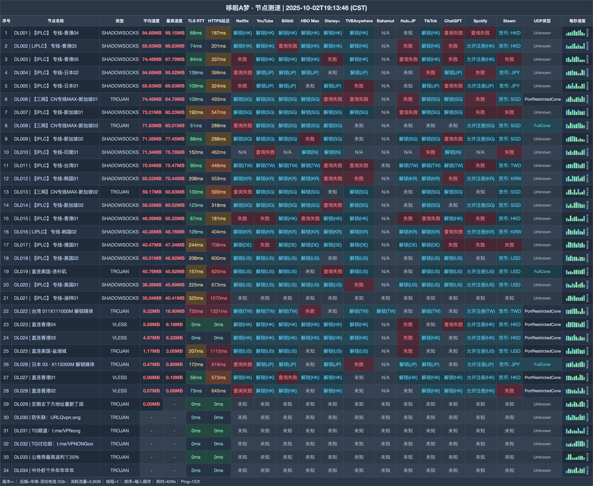

# 哆啦A梦机场｜23 元/月 135G，IPLC 与 V5 专属线路（2026-10-31 更新）

> **一句话评价：专线与大流量之选：23 元 135G 起，V5 还有 AI 专线和家宽节点**
>
> 👉 **[官网注册](https://web1.yyds2-doraemon.site/login/register?invite_code=1yjj7VQR)** · 日常使用从 23 元 Vip2 开始；需要 V5 专属节点再升级。

**适合：**

- 关注 IPLC 专线和多地区节点
- 需要月付与不限时流量包
- 希望比较 V5 AI 专线、家宽节点等页面权益

**不适合：**

- Vip2 用户需要 BT
- 准备多人共享 Vip3 及以上个人套餐

| | |
|---|---|
| 起步价 | 23 元/月 135G |
| 月付档 | 135G—1024G |
| 不限时包 | 512G—6000G |
| 设备 | 月付 2—5 台 |
| 协议 |  Trojan · VLESS · Shadowsocks |
| 高阶线路 |  V5 AI 专线 · 家宽 |

**关于哆啦A梦**：哆啦A梦（doraemon）月付 23 元/135G 起，V5 档带 AI 专线与家宽节点。

## 套餐

| 套餐 | 价格 | 流量 | 设备 | 限速 | 说明 |
|---|---:|---:|---:|---:|---|
| Vip2 135G会员 | ¥23/月付 | 135G · 每月订单日重置 | 2 | 目前不限但可能限速 | 禁止BT；无退款 |
| Vip3 230G会员 | ¥34/月付 | 230G · 每月订单日重置 | 3 | 目前不限但可能限速 | 不限制正常BT；禁止共享；无退款 |
| Vip4 350G会员高速 | ¥45/月付 | 350G · 每月订单日重置 | 4 | 目前不限但可能限速 | 不限制正常BT；禁止共享；无退款 |
| Vip5 1024G会员超高速 | ¥90/月付 | 1024G · 每月订单日重置 | 5 | 500M | 原文500M；V5专属AI专线和家宽；不限制正常BT |
| Vip5 512G不限时间 | ¥120/一次性 | 512G · 用完为止 | 不限 | 不限 | 所有节点+V5专属AI专线和家宽；不限制BT；禁止共享 |
| Vip5 1200G不限时间 | ¥240/一次性 | 1200G · 用完为止 | 不限 | 不限 | 所有节点+V5专属AI专线和家宽；不限制BT；禁止共享 |
| Vip5 2400G不限时间 | ¥480/一次性 | 2400G · 用完为止 | 不限 | 不限 | 所有节点+V5专属AI专线和家宽；不限制BT；禁止共享 |
| Vip5 6000G不限时间 | ¥1100/一次性 | 6000G · 用完为止 | 不限 | 不限 | 此档无佣金；不限制BT；禁止共享 |
| 独享海外直播专用定制家宽 | ¥9999/月付 | 10G · 仅能购买一次 | 1 | 1000M | **定制展示项**；不可续费；无偿赞助商务无需付款；禁止BT；测速请错峰；不是普通可购套餐 |

> Vip2 禁止 BT；Vip3、Vip4 和不限时档禁止共享。Vip5 月档原文写 500M，单位及适用口径未确认，不能确定化为 Mbps。6000G 档不产生本站佣金。

## 测速参考

共 34 个节点（下载/延迟），测试端 华南-深圳电信 2Gb，完整记录见下图与 `data/`。

## 怎么选

- 轻度用户可比较 Vip2：23 元、135G、2 台设备；该档禁 BT 且不退款。
- 三四台设备可比较 Vip3 / Vip4；月流量分别 230G / 350G，禁止共享。
- 长期大流量可看不限时包；512G 120 元起、用完为止，续费不等于流量重置。

## 注册

👉 **[官网注册](https://web1.yyds2-doraemon.site/login/register?invite_code=1yjj7VQR)** · 日常使用从 23 元 Vip2 开始；需要 V5 专属节点再升级。

*本文使用推广链接，注册或购买后本站可能获得佣金。*

## 更新

- **2026-10-31** — 整理当前套餐资料，共 9 个套餐/展示项；加入节点测速参考。
- **2025-10-04** — 节点测速记录日期。

---
*价格、节点和活动会变化，下单时以套餐页显示为准。*

---

相关搜索：哆啦A梦 / doraemon / 机场推荐

本文关键词：哆啦A梦、doraemon、哆啦A梦机场、哆啦机场、yyds2、机场推荐、机场测评、机场推荐2026、科学上网、代理、VPN、clash 订阅、哆啦A梦官网、哆啦A梦注册、哆啦A梦测速

